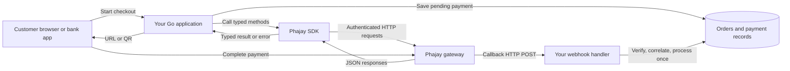
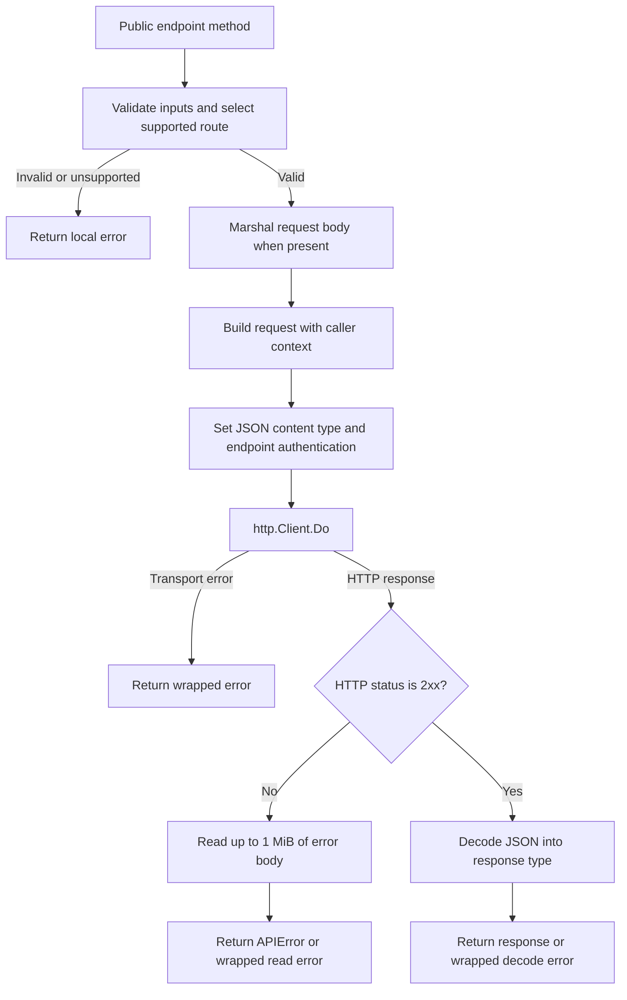
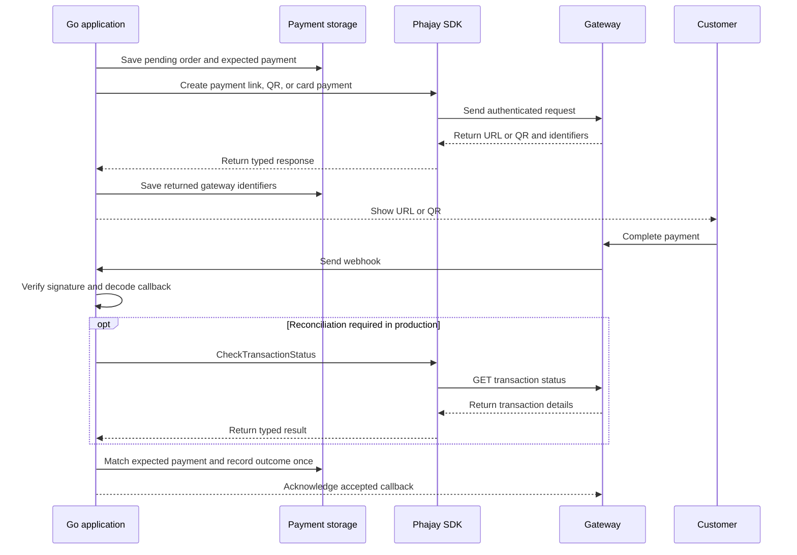

# Phajay Go SDK architecture

This document describes the implementation in this checkout. The SDK is a
single Go package named `phajay`, with module path
`github.com/barlus-developer/phajay-payment-gateway`. It requires Go 1.23 or
later and depends only on the standard library.

Use the [integration guide](INTEGRATION.md) for application examples and the
[contributor guide](../CONTRIBUTING.md) for implementation rules.

## System boundaries

The SDK constructs gateway requests and decodes responses. Your application
owns order storage, customer navigation, QR display, webhook handling,
body reading, reconciliation, and fulfillment. The SDK enforces the configured
webhook verification policy through `DecodeWebhook`.

Callbacks arrive at an application HTTP endpoint. They do not pass through the
SDK HTTP client. The application passes original body bytes and headers to
`DecodeWebhook` before processing callback data.
The SDK creates no background goroutines, polling workers, or HTTP server.

## Source map

All Go source and test files live in the repository root. Files separate
features within one package; they do not define independent packages.

| File | Responsibility |
| --- | --- |
| [`doc.go`](../doc.go) | Package documentation and supported feature overview. |
| [`phajay.go`](../phajay.go) | Config, client state, constructor, and functional options. |
| [`webhook.go`](../webhook.go) | Fail-closed verification policy and shared callback decoding. |
| [`request.go`](../request.go) | HTTP request execution, authentication, `APIError`, shared validation, path escaping, and production-only guard. |
| [`payment_link.go`](../payment_link.go) | Payment link request/response types and production/sandbox route selection. |
| [`payment_qr.go`](../payment_qr.go) | Bank constants, QR types, bank route lookup, and sandbox restrictions. |
| [`transaction.go`](../transaction.go) | Transaction lookup, nullable response details, and status constants. |
| [`refund.go`](../refund.go) | Refund creation, bill lookup, and numeric/string amount decoding. |
| [`payment_credit_card.go`](../payment_credit_card.go) | Hosted card payment link creation. |
| [`subscription.go`](../subscription.go) | BCEL authorization QR creation and authorization cancellation. |
| [`payment_link_webhook.go`](../payment_link_webhook.go) | Production link callback and compatible `refNo` decoding. |
| [`payment_qr_webhook.go`](../payment_qr_webhook.go) | QR callback and `FlexibleString` decoding. |
| [`payment_credit_card_webhook.go`](../payment_credit_card_webhook.go) | Card callback and optional nested card details. |
| [`subscription_webhook.go`](../subscription_webhook.go) | Subscription event payload and status constants. |
| [`payment_link_sandbox_webhook.go`](../payment_link_sandbox_webhook.go) | Separate sandbox link callback schema. |

## Client construction and lifetime

`New(Config, opts...)` creates a `*Phajay` with private fields for its API key,
base URL, `*http.Client`, sandbox flag, webhook signing key, and bypass flag. Defaults are the gateway host
`https://payment-gateway.phajay.co`, a 30-second timeout, production routes,
and mandatory webhook verification (`BypassSignatureVerification: false`).
`Config.BaseURL` overrides the host when non-empty. The signing key is separate
from the API key; missing signing configuration never enables bypass.

`Option` is `func(*Phajay)`. Options apply after Config, in the supplied order during `New`:

| Option | Effect |
| --- | --- |
| `WithBaseURL` | Replace the gateway base URL, overriding Config. |
| `WithHTTPClient` | Copy a supplied `http.Client` value; nil preserves the current client. |
| `WithTimeout` | Set the configured client's timeout; zero disables it. |
| `WithSandbox` | Select supported test routes and reject other operations. |

The `http.Client` copy is shallow. Its transport, cookie jar, and other
referenced objects remain shared. A later timeout option changes the copy's
timeout, while a later HTTP client option replaces that timeout with the
supplied client's value.

Clients may be shared between goroutines after construction, provided the HTTP
client and shared dependencies are safe for concurrent use and are not modified
during requests. Request bodies, responses, and errors are local to each call.
There is no client shutdown method or internal worker lifecycle; custom transport
resource management belongs to the application.

`New` returns a client directly. It does not validate credentials or perform a
connectivity check. Endpoint input validation happens when methods are called.

## Request processing

Each public endpoint method chooses a route and authentication scheme, validates
its inputs and environment, then calls `p.do`. The precise order of bank lookup,
validation, and environment checks varies by method; all failures occur before
HTTP execution.

The helper trims trailing slashes from the base URL and appends the selected
path. It uses `http.NewRequestWithContext`, sets `Content-Type: application/json`,
and closes response bodies with `defer` after receiving an HTTP response.
`pathID` escapes lookup identifiers with `url.PathEscape`; it rejects blank
identifiers and the exact values `.` and `..`.

A non-2xx response becomes `*APIError` with `StatusCode`, `Operation`, and a
trimmed response `Body` capped at 1 MiB. An error while reading that body is
wrapped instead. A 2xx response must contain decodable JSON; an empty body
produces a decoding error. Successful response bodies are not subject to the
error body's size cap. The helper does not translate response messages into
business errors or enforce a completed payment state.

SDK errors begin with `phajay: `. Underlying marshal, request construction,
transport, response reading, and decoding errors use `%w`, allowing
`errors.Is` and `errors.As`. Local validation errors are plain errors, with no
exported validation error type.

There is no SDK retry loop. Each method invokes the HTTP helper once. The
configured HTTP client controls transport and redirect behavior. Application
retry decisions must account for a request being accepted before a response was
lost, especially for payment creation, refunds, and authorization changes.

## Routes and authentication

The following paths are implemented in the source. `Basic` means
`Authorization: Basic <base64(raw API key)>`; the encoding does not add a
username/password separator. `secretKey` means the raw key in that header.

| Method | HTTP | Production path | Authentication | Sandbox |
| --- | --- | --- | --- | --- |
| `CreatePaymentLink` | POST | `/v1/api/link/payment-link` | Basic | `/v1/api/test/payment/get-payment-link` |
| `GenerateQR` | POST | `/v1/api/payment/generate-{bank}-qr` | `secretKey` | `/v1/api/test/payment/generate-{bank}-qr` for JDB/LDB/IB/BCEL/STB |
| `CheckTransactionStatus` | GET | `/v1/api/payment/check-transaction/status/{transactionId}` | Basic | Rejected locally |
| `RequestRefund` | POST | `/v1/api/refund` | `secretKey` | Rejected locally |
| `CheckRefundStatus` | GET | `/v1/api/refund/{billId}` | `secretKey` | Rejected locally |
| `CreateCreditCardPaymentLink` | POST | `/v1/api/jdb2c2p/payment/payment-link` | Basic | Rejected locally |
| `GenerateSubscriptionQR` | POST | `/v1/api/subscription/generate-bcel-qr` | `secretKey` | Rejected locally |
| `CancelSubscription` | POST | `/v1/api/subscription/cancel-subscription` | `secretKey` | Rejected locally |

The QR route's `{bank}` is `jdb`, `ldb`, `ib`, `bcel`, or `stb`. M MoneyX uses
`/v1/api/payment/generate-m-money-qr` and is rejected in sandbox. Unknown `Bank`
values are rejected by `bankPath`.

Sandbox uses the same default host as production. Unsupported methods call
`requireProduction` and return before sending HTTP. They cannot silently use a
production route through a sandbox client.

## Validation and wire types

`validatePayment` enforces a finite amount greater than zero and a description
containing non-whitespace text. Link, QR, and card creation share this helper.
Subscription QR creation separately validates a finite positive `MaxAmount`, a
date parseable as `YYYY-MM-DD`, positive `ResubscriptionDays`, and a description.
Refund creation and subscription cancellation require nonblank identifiers.
Transaction and refund status lookups use `pathID`.

Validation does not normalize the supplied description or identifier. The
request structs and JSON tags define serialization. For example, empty QR
`OrderNo` and empty card tags use `omitempty`; payment link fields have no
`omitempty`. Amounts use `float64` as exposed by the public API. The SDK has no
decimal money type or currency conversion layer. Date and timestamp response
fields retain gateway strings.

## Callback decoding

Callback types describe JSON payloads independently of `*Phajay`. Use a fresh
callback value for each request. JSON decoding alone does not verify the sender
or check that all documented fields were included.

| Payload | Value fields | Optional fields and compatibility |
| --- | --- | --- |
| Production link | `PaymentMethod`, `LinkCode`, `TransactionID`, `OrderNo`, `TxnAmount` | Other fields are `*string`; custom unmarshalling accepts numeric or string `RefNo`. |
| QR | `PaymentMethod`, `TransactionID`, `TxnAmount` | Other fields are pointers, including `BillNumber`, `Status`, and `*FlexibleString` `RefNo`. |
| Credit card | No guaranteed subset modeled | All fields and nested details are pointers. |
| Subscription | `Message`, `Status`, `TransactionID`, `AuthCode`, `Time` | `PaymentTransactionID` is optional and belongs to debit events. |
| Sandbox link | No guaranteed subset modeled | All fields are pointers; wire keys include `amount`, `user`, `_id`, `descriptione`, and `updateAt`. |

`FlexibleString.UnmarshalJSON` accepts string and number representations and
preserves numeric text through `json.Number`. This avoids rounding a large
reference through `float64`. Missing or null optional references remain nil
when decoding a fresh callback. Link decoding reuses this conversion internally
while preserving its public `*string` field type. Refund amount decoding also
accepts numbers and numeric strings, then converts the value to `float64`.

The [public webhook verification guide](https://payment-doc.lailaolab.com/v1/verify-webhook-signature)
withholds the signing algorithm, signed payload, encoding, header name, and key
format. `VerifyWebhookSignature(rawBody, headers)` therefore fails closed:
missing/blank signing keys return `ErrWebhookSignatureKeyMissing`; all requests
with configured keys return `ErrWebhookSignatureVerificationUnavailable`.
No cryptographic algorithm or comparison is implemented without the private guide.

`DecodeWebhook(rawBody, headers, callback)` calls verification before
`json.Unmarshal` and leaves the target untouched on a verification failure.
The application supplies exact original bytes and a non-nil callback pointer.
With explicit bypass, verification returns nil without examining the body,
headers, or key. Bypassed callbacks remain unauthenticated and are only suitable
for development and tests. Sandbox does not enable bypass. Direct JSON decoding
of callback types remains unauthenticated and does not apply client policy.

## Payment processing in an application

This sequence is an integration pattern; persistence and fulfillment are
implemented by the application:

Creation responses provide a way for the customer to pay. Completion requires
matching a verified callback or authenticated status response to the saved
payment. A browser redirect alone does not establish payment completion. For
status responses, require non-nil `Data`, `IsPaid == true`, and
`Status == TransactionStatusCompleted` before fulfillment.

Subscription authorization, recurring debit, and cancellation are separate
events. A refund request starts a workflow identified by the returned refund
bill ID. The SDK returns these states to the application and does not maintain
a payment state machine.

## Test and documentation map

| Files | Coverage area |
| --- | --- |
| `phajay_test.go` | Config, options, client copying, underlying errors, and error body limit. |
| `payment_link_test.go`, `payment_qr_test.go` | Payment requests, bank routes, validation, and gateway errors. |
| `endpoints_test.go` | Status, refund, card, and subscription methods; auth, payloads, cancellation, response variants, and escaped identifiers. |
| `sandbox_test.go` | Supported sandbox routes and M MoneyX rejection. |
| `webhook_test.go` | Mandatory verification, fail-closed errors, unchanged targets on rejection, explicit bypass for every callback type, and JSON errors. |
| `callbacks_test.go`, `*_webhook_test.go` | Minimal callback payloads, null fields, reference precision, nested card fields, subscription events, and refund amounts. |

Tests use local `httptest` servers and literal JSON payloads. They require no
gateway credentials. The [CI workflow](../.github/workflows/test.yml) runs
`go test ./... -race -cover` on Go 1.23. Formatting and vet commands are listed
in [CONTRIBUTING.md](../CONTRIBUTING.md).

For public API changes, update the [README reference](../README.md#api-reference),
[changelog](../CHANGELOG.md), and [contributor guide](../CONTRIBUTING.md), plus
the integration and architecture sections affected by the change.
